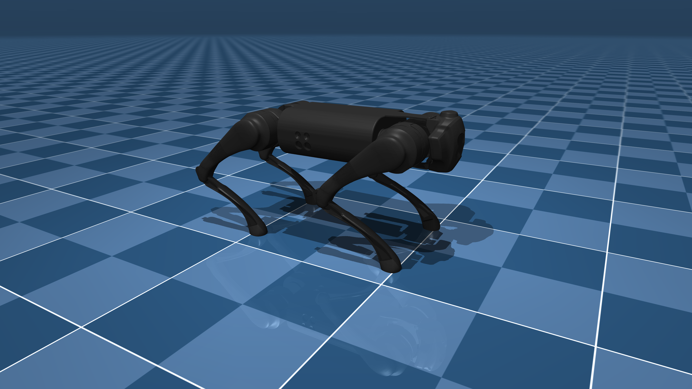

# Unitree Go1 

  

## Il Motore Fisico e l'Ambiente di Simulazione

### MuJoCo (Multi-Joint dynamics with Contact)
È il cuore della simulazione. Sviluppato originariamente per la ricerca in robotica e ora mantenuto da Google 
DeepMind, è un motore fisico estremamente veloce e preciso. 
Cosa fa: Calcola in tempo reale la gravità, l'attrito, le collisioni e le forze che agiscono sui 12 motori (giunti) del Go1.
Perché lo usiamo: Ci permette di testare pose, transizioni e il controllo PD (Proporzionale-Derivativo) in totale sicurezza, senza r
ischiare di rompere il robot fisico.

**MuJoCo Menagerie**
È la libreria ufficiale dei modelli robotici curata da DeepMind.
Fornisce i file .xml (come il nostro scene.xml) che descrivono la geometria, le masse, i limiti dei giunti e i colori del robot.
Abbiamo usato il modello Unitree Go1, già calibrato con i pesi e le dimensioni reali del cane robot.

**mujoco.viewer**
È l'interfaccia grafica (basata su GLFW) che ci permette di vedere la simulazione in 3D, muovere la telecamera
e, soprattutto, intercettare gli input da tastiera per i test manuali.

## Lo Stack di Visione e Intelligenza Artificiale

### OpenCV (opencv-python e opencv-contrib-python)
È la libreria standard per la computer vision.
 Gestisce l'apertura della webcam, cattura i frame video e li converte in scala di grigi.
**Haar Cascades**: Abbiamo usato i classificatori Haar (file .xml di OpenCV) per il rilevamento veloce e leggero dei volti. 
È il primo filtro che decide se c'è qualcuno davanti al robot.

**DeepFace**
È un framework Python che semplifica l'uso di reti neurali complesse per l'analisi del volto.
Analizza il volto rilevato da OpenCV e restituisce un dizionario con le percentuali delle emozioni (es. happy: 85.4%, sad: 2.1%).
Sotto il cofano, DeepFace usa TensorFlow e tf-keras per eseguire le reti neurali (come VGG-Face o Facenet) che estraggono i tratti somatici.

**MediaPipe**
Sviluppata da Google, è una libreria per il tracciamento del corpo e delle mani in tempo reale.
Ruolo nel progetto: Anche se nello script finale ci siamo concentrati sul volto, MediaPipe è stata installata e testata per rilevare i
33 punti chiave del corpo umano. Sarà utilissima in futuro se vorremo far imitare al robot i movimenti delle braccia o della postura dell'utente.

### Lo Stack Matematico e le Dipendenze "Nascoste"
Queste librerie sono il collante che tiene insieme tutto il sistema.
**NumPy (numpy)**
È la base del calcolo scientifico in Python.
Gestisce gli array multidimensionali. Le pose del robot (es. sad_pose) sono array NumPy a 12 dimensioni.
L'interpolazione smoothstep e le operazioni matriciali del controllo PD si basano interamente su di esso.

**TensorFlow (tensorflow)** e **tf-keras**
Sono i motori di calcolo per il machine learning.
Sono richiesti da DeepFace per caricare ed eseguire i modelli di riconoscimento facciale. 
(Nota: li usiamo in modalità CPU, dato che non abbiamo GPU dedicate in questo ambiente).

**Protobuf (protobuf)**
È una libreria di Google per la serializzazione dei dati strutturati.
Il problema risolto: È stata la causa principale del nostro "inferno delle dipendenze". TensorFlow, MediaPipe e OpenCV 
richiedevano versioni di Protobuf incompatibili tra loro. Abbiamo dovuto trovare la versione ponte (4.25.3) per farle convivere.

## Sistema Emozioni (Emotion Vision System)

Il robot Go1 implementa un sistema di emozioni reattivo basato su visione artificiale, 
che combina rilevamento della presenza (Haar Cascade) e riconoscimento delle emozioni facciali (DeepFace). 
Il sistema gestisce tre stati emotivi con transizioni fluide e comportamenti distintivi.

### Architettura del Sistema
Il sistema opera su due livelli di rilevamento:

    Haar Cascade (10Hz): Rilevamento rapido della presenza di un volto
    DeepFace (0.5Hz): Analisi dell'emozione facciale ogni 1.5 secondi

### Struttura attuale del sistema emotivo
Il sistema trasforma il robot da una semplice macchina a un compagno reattivo e "vivente", capace di
osservare e rispondere all'umore umano. 
Il robot inizia il suo ciclo in stato di riposo **(SAD)**: è sdraiato a terra, con il corpo abbassato e i fari spenti, 
simulando un cane rilassato o malinconico. 

Non appena la telecamera percepisce la presenza costante di una persona, il robot si alza con 
un movimento fluido e graduale, passando allo stato attento **(READY)**. In questa fase, assume una postura eretta e 
accende i fari frontali di luce bianca, segnalando che ha notato l'utente.

Se l'interazione si fa positiva e la persona sorride, il robot esplode di gioia **(HAPPY)**: con uno scatto rapido ed energico, 
esegue un saltino allegro e tinge i suoi fari di verde brillante. 
Quando il sorriso svanisce, il robot si calma dolcemente, tornando allo stato attento. Infine, se la persona si allontana,
il sistema non reagisce in modo nervoso: attende qualche secondo per poi "accasciarsi" lentamente a terra, tornando allo stato di riposo. 
Grazie a un'interpolazione matematica che sincronizza perfettamente l'estensione delle zampe con l'altezza del torso, 
ogni transizione è priva di scatti meccanici. Il risultato è un robot con una personalità canina, empatica e incredibilmente naturale.

